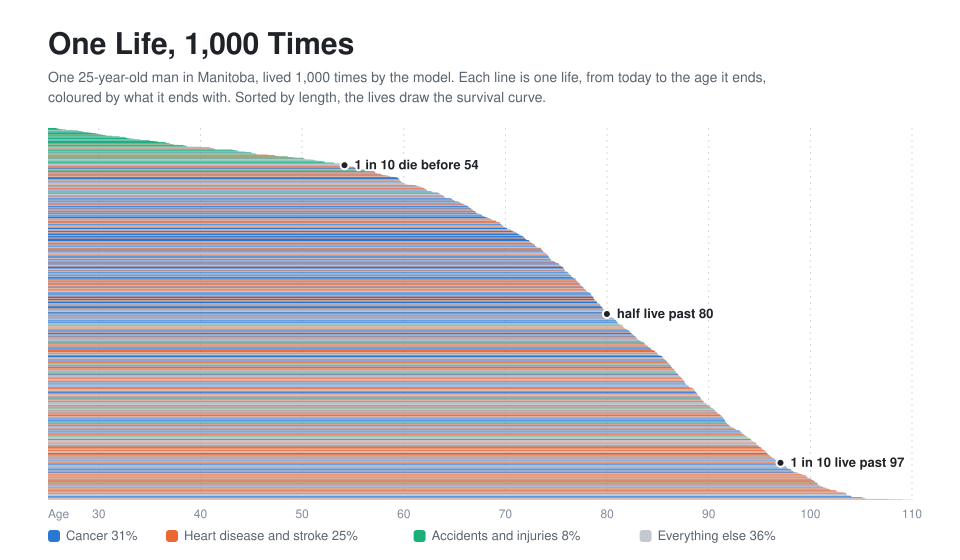
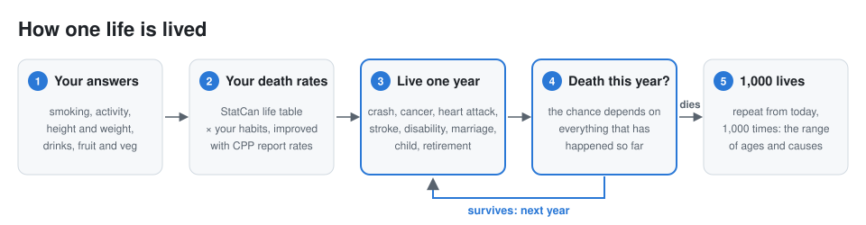
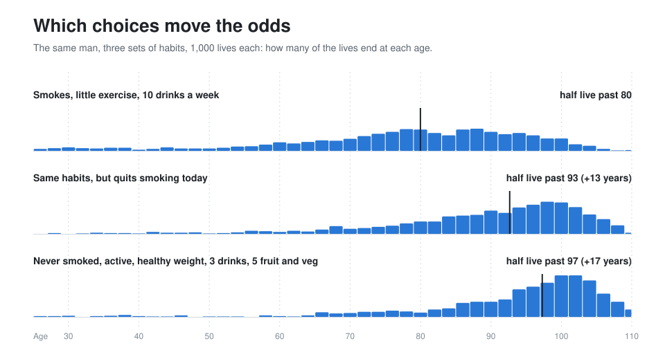

<p align="center">
  <picture>
    <source media="(prefers-color-scheme: dark)" srcset="docs/figures/lives-dark.svg">
    
  </picture>
</p>

<h3 align="center"><i>Nobody can tell you how your life will go. Here are 1,000 ways it could.</i></h3>

<p align="center">
  <a href="https://github.com/soodpratham10/one-life-1000-times/actions/workflows/tests.yml"></a>
  <a href="https://github.com/soodpratham10/one-life-1000-times/releases"></a>
  
  
  <a href="LICENSE"></a>
</p>

<p align="center">
  <a href="#what-this-is">What this is</a> ·
  <a href="#how-a-life-is-lived">How a life is lived</a> ·
  <a href="#which-choices-move-the-odds">Choices</a> ·
  <a href="#roadmap">Roadmap</a> ·
  <a href="#data">Data and sources</a> ·
  <a href="#run-it-locally">Run it</a>
</p>

> [!NOTE]
> **In development.** The engine is built and tested: it lives a person's life forward year by year, 1,000 times, with cancer, heart attacks, strokes, marriage and disability all changing later death risk. The survey and website are not built yet. Releases: [v0.1.0](https://github.com/soodpratham10/one-life-1000-times/releases/tag/v0.1.0) (data), [v0.2.0](https://github.com/soodpratham10/one-life-1000-times/releases/tag/v0.2.0) (engine), [v0.3.0](https://github.com/soodpratham10/one-life-1000-times/releases/tag/v0.3.0) (links between events).

## What this is

A life simulator built on real Canadian data. You answer a short survey; the model lives your life forward year by year (health, accidents, family, work, and how it ends), then does it again, 1,000 times, so you can see the realistic range of how things could go and which of your choices move the odds.

**Aim (draft):** show someone the realistic range of how their life could unfold, using the data and methods actuaries use, and show which of their choices actually change the odds.

> [!IMPORTANT]
> **What this is not**
> - Not a prediction of when or how you will die. No model can do that for one person; this shows probabilities.
> - Not medical, financial or insurance advice.
> - Not an insurance price. There are no premiums or reserves in this project.

## How a life is lived

The structure follows how life insurers underwrite: a base mortality table, personal risk multipliers, future mortality improvement, competing risks between events, and an actual-to-expected check against official data. Published data is used where insurers use proprietary underwriting manuals. Every assumption, its source and its weakness is listed in [`docs/assumptions.md`](docs/assumptions.md).

<p align="center">
  <picture>
    <source media="(prefers-color-scheme: dark)" srcset="docs/figures/how-dark.svg">
    
  </picture>
</p>

| Event | How it works in the model |
| --- | --- |
| 🕯️ Death, by cause | 11 cause groups plus "all other causes" (see A06) |
| ♿ Disability | CPP-style severe and prolonged disability; disabled people die at several times the usual rate, and a spell can end in recovery |
| 🚗 Injured in a car crash | Police-reported injury of any severity; can happen more than once |
| 🎗️ Cancer diagnosis | Lung or other site; cancer deaths come only after a diagnosis |
| ❤️ Heart attack or stroke | First one only; can be fatal within the year, and survivors carry more risk |
| 💍 Marriage, divorce, remarriage | Legal marriage; married people have lower death rates (divorced and never married higher) |
| 👶 First child | |
| 🏖️ Retirement | Starting the CPP retirement pension, ages 60–70 |

Widowhood, job loss and home purchase are planned for version 2.

## Which choices move the odds

<p align="center">
  <picture>
    <source media="(prefers-color-scheme: dark)" srcset="docs/figures/choices-dark.svg">
    
  </picture>
</p>

Each survey answer moves your death rates by a hazard ratio from a large published study. All ratios, with their sources, are in [`data/assumptions/hazard_ratios.csv`](data/assumptions/hazard_ratios.csv).

| Question | Study |
| --- | --- |
| 🚬 Smoking: never, former (and the age you quit), current | [Jha et al., *NEJM* 2013](https://doi.org/10.1056/NEJMsa1211128); [Pirie et al., *Lancet* 2013](https://doi.org/10.1016/S0140-6736(12)61720-6) |
| 🏃 Minutes of moderate or vigorous activity a week | [Arem et al., *JAMA Internal Medicine* 2015](https://doi.org/10.1001/jamainternmed.2015.0533) |
| ⚖️ Height and weight (BMI) | [Global BMI Mortality Collaboration, *Lancet* 2016](https://doi.org/10.1016/S0140-6736(16)30175-1) |
| 🍺 Drinks a week | [Zhao et al., *JAMA Network Open* 2023](https://doi.org/10.1001/jamanetworkopen.2023.6185) |
| 🥦 Servings of fruit and vegetables a day | [Wang et al., *Circulation* 2021](https://doi.org/10.1161/CIRCULATIONAHA.120.048996) |

Official death rates already include everyone, smokers and non-smokers alike, so the model first divides out the Canadian population's average mix of these habits (from the Canadian Community Health Survey) and then applies yours. Smoking also changes what people die of (lung cancer and COPD far more than other causes), using cause-specific ratios from [Thun et al., *NEJM* 2013](https://doi.org/10.1056/NEJMsa1211127). A check: with these ratios, the gap between the healthiest and least healthy habits comes out at about 18 years of life expectancy, close to the 17.9 years found for Canada by the MPoRT study ([Manuel et al., *PLOS Medicine* 2016](https://doi.org/10.1371/journal.pmed.1002082)).

Both figures are drawn from the engine's own simulated lives by [`docs/figures/make_figures.py`](docs/figures/make_figures.py); no number on them is typed in.

## Roadmap


| Phase | What it covers | Status |
| --- | --- | --- |
| 0. Setup | Environment, repository, licence | ✅ Done |
| 1. Data | Pipeline, cleaned tables, assumptions register, data dictionary, tests | ✅ Done ([v0.1.0](https://github.com/soodpratham10/one-life-1000-times/releases/tag/v0.1.0)) |
| 2. Engine | Mortality projection, survey risk multipliers, competing risks, 1,000 simulated lives | ✅ Done ([v0.2.0](https://github.com/soodpratham10/one-life-1000-times/releases/tag/v0.2.0)) |
| 3. Links between events | Cancer deaths after a diagnosis, deaths after a heart attack or stroke, marriage effects, disability recovery vs death | ✅ Done ([v0.3.0](https://github.com/soodpratham10/one-life-1000-times/releases/tag/v0.3.0)) |
| 4. Validation | Actual-to-expected checks against official figures; independent R and Excel cross-checks | 🔜 Next |
| 5. Website | Survey and interactive visuals | ⬜ Planned |
| 6. Launch | Write-up and release | ⬜ Planned |

## Data

All inputs come from official public sources, and every source below links straight to the original so you can check it yourself. Every cleaned file and column is described in [`docs/data_dictionary.md`](docs/data_dictionary.md).

> [!TIP]
> The three sections below are folded to keep the page short. **Click a heading (▶) to open it.**

<details>
<summary><h3>📊 Data sources (14) <sub><i>· click to open</i></sub></h3></summary>

| Source | Used for |
| --- | --- |
| Statistics Canada, life tables: [13-10-0114-01](https://www150.statcan.gc.ca/t1/tbl1/en/tv.action?pid=1310011401); PEI abridged table [13-10-0140-01](https://www150.statcan.gc.ca/t1/tbl1/en/tv.action?pid=1310014001) | Base death rates by age, sex and province |
| Canadian Institute of Actuaries, [Mortality Improvements Research – Tables (MI-2024)](https://www.cia-ica.ca/?p=333613) and [report](https://www.cia-ica.ca/publications/224043e/) | Future mortality improvement (not committed; see below) |
| Statistics Canada, deaths by cause: [13-10-0392-01](https://www150.statcan.gc.ca/t1/tbl1/en/tv.action?pid=1310039201) | Splitting deaths into 12 cause groups |
| Transport Canada, [National Collision Database (open data)](https://open.canada.ca/data/en/dataset/1eb9eba7-71d1-4b30-9fb1-30cbdab7e63a) | Car crash injuries |
| Statistics Canada, new cancer cases: [13-10-0111-01](https://www150.statcan.gc.ca/t1/tbl1/en/tv.action?pid=1310011101) | Cancer diagnoses |
| Public Health Agency of Canada, [Canadian Chronic Disease Surveillance System data tool](https://health-infobase.canada.ca/ccdss/data-tool/) | Heart attacks and strokes |
| Office of the Chief Actuary, [32nd Actuarial Report on the Canada Pension Plan (revised)](https://www.osfi-bsif.gc.ca/en/oca/actuarial-reports/actuarial-report-32nd-canada-pension-plan-revised-version) | Disability and retirement |
| Office of the Chief Actuary, [Actuarial Study No. 16: CPP beneficiaries mortality study (2015)](https://publications.gc.ca/site/eng/9.804327/publication.html) | Death rates of CPP disability beneficiaries |
| Statistics Canada, marriages [39-10-0057-01](https://www150.statcan.gc.ca/t1/tbl1/en/tv.action?pid=3910005701), divorces [39-10-0053-01](https://www150.statcan.gc.ca/t1/tbl1/en/tv.action?pid=3910005301), births by parity [13-10-0421-01](https://www150.statcan.gc.ca/t1/tbl1/en/tv.action?pid=1310042101) | Marriage, divorce, remarriage, first child |
| Statistics Canada, population: [17-10-0005-01](https://www150.statcan.gc.ca/t1/tbl1/en/tv.action?pid=1710000501) | Denominators for event rates |
| Statistics Canada, population by legal marital status: [17-10-0060-01](https://www150.statcan.gc.ca/t1/tbl1/en/tv.action?pid=1710006001) | Canada's marital mix by age, to apply marriage death ratios |
| Statistics Canada, Canadian Community Health Survey: [13-10-0096-01](https://www150.statcan.gc.ca/t1/tbl1/en/tv.action?pid=1310009601) | How common smoking, inactivity, obesity and low fruit and vegetable intake are, by age and sex |
| Health Canada, [Canadian Tobacco and Nicotine Survey 2019, detailed tables](https://www.canada.ca/en/health-canada/services/canadian-tobacco-nicotine-survey/2019-summary/2019-detailed-tables.html) | How common former smokers are, by age and sex |
| Statistics Canada, [Adult obesity in Canada: measured height and weight (CCHS 2004)](https://www150.statcan.gc.ca/n1/pub/82-620-m/2005001/article/adults-adultes/8060-eng.htm) | Split of obesity into classes I–III |

</details>

<details>
<summary><h3>📚 Studies behind the hazard ratios and checks (17) <sub><i>· click to open</i></sub></h3></summary>

Every hazard ratio and published figure the engine uses, with a link to the paper. The exact numbers taken from each are in [`data/assumptions/`](data/assumptions/) and [`docs/assumptions.md`](docs/assumptions.md).

| Study | Used for |
| --- | --- |
| Jha et al. (2013), [21st-century hazards of smoking and benefits of cessation in the United States](https://doi.org/10.1056/NEJMsa1211128), *NEJM* | Smoking: current smokers, quitting at 45–54, "other causes" ratio |
| Pirie et al. (2013), [The 21st century hazards of smoking and benefits of stopping (Million Women Study)](https://doi.org/10.1016/S0140-6736(12)61720-6), *Lancet* | Quitting before 35 and at 35–44 |
| Thun et al. (2013), [50-year trends in smoking-related mortality in the United States](https://doi.org/10.1056/NEJMsa1211127), *NEJM* | Smoking ratios by cause of death (lung cancer, COPD, heart disease, stroke) |
| Arem et al. (2015), [Leisure time physical activity and mortality](https://doi.org/10.1001/jamainternmed.2015.0533), *JAMA Internal Medicine* | Physical activity |
| Global BMI Mortality Collaboration (2016), [Body-mass index and all-cause mortality](https://doi.org/10.1016/S0140-6736(16)30175-1), *Lancet* | Body-mass index |
| Zhao et al. (2023), [Association between daily alcohol intake and risk of all-cause mortality](https://doi.org/10.1001/jamanetworkopen.2023.6185), *JAMA Network Open* | Alcohol |
| Wang et al. (2021), [Fruit and vegetable intake and mortality](https://doi.org/10.1161/CIRCULATIONAHA.120.048996), *Circulation* | Fruit and vegetables |
| Manuel et al. (2016), [Life expectancy lost in Canada attributable to smoking, alcohol, physical inactivity, and diet (MPoRT)](https://doi.org/10.1371/journal.pmed.1002082), *PLOS Medicine* | Check: healthiest vs least healthy habits |
| Canadian Cancer Society, [Canadian Cancer Statistics](https://cancer.ca/en/research/cancer-statistics/canadian-cancer-statistics) (2023) | Lung cancer survival (5 and 10 years), for the cancer link and its check |
| Boucher et al. (2001), [Age-related differences in in-hospital mortality and the use of thrombolytic therapy for acute myocardial infarction](https://pmc.ncbi.nlm.nih.gov/articles/PMC81018), *CMAJ* | How heart attack fatality rises with age |
| Li et al. (2022), [Impact of including out-of-hospital deaths on 30-day in-hospital mortality indicators](https://cmajopen.ca/content/10/4/E882), *CMAJ Open* (CIHI) | 30-day heart attack mortality, 6.5% |
| Joundi et al. (2021), [Temporal trends in case fatality … after acute stroke](https://doi.org/10.1212/WNL.0000000000011791), *Neurology* | 30-day stroke case fatality, 13.2% |
| [Mortality and morbidity trends after the first year in survivors of acute myocardial infarction: a systematic review](https://doi.org/10.1186/s12872-017-0482-9) (2017), *BMC Cardiovascular Disorders*; [Excess long-term mortality among hospital survivors of AMI (SAMI)](https://cris.bgu.ac.il/en/publications/excess-long-term-mortality-among-hospital-survivors-of-acute-myoc-2/) (2017), *Public Health* | Range for heart attack and stroke survivors' extra risk |
| Roelfs et al. (2011), [The rising relative risk of mortality for singles](https://doi.org/10.1093/aje/kwr111), *American Journal of Epidemiology* | Never married |
| Shor et al. (2012), [Meta-analysis of marital dissolution and mortality](https://pubmed.ncbi.nlm.nih.gov/22534377/), *Social Science & Medicine* | Divorced and separated |
| Shor et al. (2012), [Widowhood and mortality: a meta-analysis and meta-regression](https://academiccommons.columbia.edu/doi/10.7916/D8DR2VR9), *Demography* | Widowed |
| Statistics Canada, [Health Fact Sheet: Smoking, 2019](https://www150.statcan.gc.ca/n1/pub/82-625-x/2020001/article/00003-eng.htm) | Check on the smoking figures |

</details>

<details>
<summary><h3>🛠️ Full source details, and how to get the hand-downloaded files <sub><i>· click to open</i></sub></h3></summary>

| Source | What it gives | In this repo? |
| --- | --- | --- |
| Statistics Canada, Table 13-10-0114-01 (complete life tables, three-year estimates) | Death probabilities by single age 0–110+, sex, Canada and 9 provinces, 1980–1982 to 2022–2024 | Cleaned copy yes (`data/clean/life_tables.csv`); raw file is re-downloaded by `pipeline/01_download_life_tables.py` |
| Statistics Canada, Table 13-10-0140-01 (abridged life tables, PEI) | PEI death probabilities by age group; turned into single ages by borrowing the within-group shape of NS and NB (see A10 in `docs/assumptions.md`) | Derived single-age table yes (`data/clean/life_tables_pei.csv`); raw file via `python pipeline/download_statcan.py 13100140` |
| Statistics Canada, Table 13-10-0392-01 (deaths by selected grouped causes) | Deaths by 12 cause groups, sex and 5-year age group, Canada, 2000–2024 | Cleaned copy yes (`data/clean/causes_of_death.csv`); raw file via `python pipeline/download_statcan.py 13100392` |
| Transport Canada, National Collision Database (open data, 2019 and 2020) | People injured and killed in police-reported collisions, by sex and age | Cleaned counts yes (`data/clean/crash_casualties.csv`); raw files downloaded by `pipeline/06_clean_ncdb.py` |
| Statistics Canada, Table 17-10-0005-01 (population on July 1, by age and gender) | Population by province, sex and single age, 2000–2026: the denominator for event rates | Cleaned copy yes (`data/clean/population.csv`); raw file via `python pipeline/download_statcan.py 17100005` |
| Statistics Canada, Table 13-10-0111-01 (new cases of primary cancer) | New cancer cases (all, and lung) by sex and 5-year age group, Canada, Quebec and Canada excluding Quebec, 1992–2023 | Cleaned extract yes (`data/clean/cancer_incidence.csv`); raw file (about 1.8 GB) via `python pipeline/download_statcan.py 13100111` |
| Public Health Agency of Canada, Canadian Chronic Disease Surveillance System (Health Infobase data tool) | Newly identified heart attacks and strokes by sex and 5-year age group, Canada and provinces, 2000–01 to 2023–24 | Cleaned copy yes (`data/clean/heart_stroke_incidence.csv`); raw files downloaded by hand (below) |
| Office of the Chief Actuary (OSFI), 32nd Actuarial Report on the Canada Pension Plan (Tables 73, 76, 85, 88) | CPP disability: chance per year of a severe and prolonged disability by age and sex, how long it lasts, and the share of adults eligible. Retirement: share starting the CPP pension at each age 60–70 | Extracted tables yes (`data/clean/cpp_disability_*.csv`, `data/clean/cpp_retirement.csv`); report PDF downloaded by hand (below) |
| Statistics Canada, Table 13-10-0096-01 (health characteristics, Canadian Community Health Survey) | Percent of people who smoke, drink heavily, are active 150+ minutes a week, are overweight or obese, or eat fruit and vegetables 5+ times a day, by sex and age group (18–34, 35–49, 50–64, 65+), Canada and provinces, 2015–2022 | Cleaned copy yes (`data/clean/risk_prevalence.csv`); raw file via `python pipeline/download_statcan.py 13100096` |
| Statistics Canada, Tables 39-10-0057-01, 39-10-0053-01 and 13-10-0421-01 (marriages, divorces, births by parity) | First marriage, remarriage, divorce and first-child rates by sex and age group, Canada, 2019 | Rates yes (`data/clean/family_events.csv`); raw files via `python pipeline/download_statcan.py 39100057` (and `39100053`, `13100421`) |
| Statistics Canada, Table 17-10-0060-01 (population by legal marital status, age and sex) | Share of Canadians single, married, separated, widowed or divorced, by sex and single age 15–100, Canada and provinces, 2015–2022 | Cleaned copy yes (`data/clean/marital_status.csv`); raw file (about 420 MB) via `python pipeline/download_statcan.py 17100060` |
| Office of the Chief Actuary, Actuarial Study No. 16 (2015), Table 40 | Death rates of CPP disability beneficiaries by sex and age 20–64, and their ratio to the population, 2011 | Typed in (`data/assumptions/disabled_mortality.csv`) |
| Health Canada, Canadian Tobacco and Nicotine Survey 2019, Table 1 | Percent of former smokers by sex and age group (25–44, 45+) | Typed in (`data/assumptions/former_smokers.csv`) |
| Canadian Institute of Actuaries, MI-2024 mortality improvement scale ("Mortality Improvements Research – Tables", 2024) | Annual improvement rates by sex, age 20–120 and calendar year 1981–2119 | **No.** The scale is the CIA's copyrighted material. Download it yourself (below) |

### Getting the CIA MI-2024 file

1. Download "Mortality Improvements Research – Tables" from the [CIA website](https://www.cia-ica.ca/?p=333613) (publication 224043).
2. Save it as `data/raw/cia_mi2024/224043te.xlsx`.
3. Run `python pipeline/03_clean_mi2024.py`.

Without it, the MI-2024 tests are skipped rather than failed.

### Getting the CCDSS heart attack and stroke files

1. Open the [CCDSS data tool](https://health-infobase.canada.ca/ccdss/data-tool/) and choose the **Age Distribution** view.
2. Condition **Acute myocardial infarction**, measure **Crude incidence rate**; click **Download Detailed Table**. Save as `data/raw/ccdss/ccdss_ami_by_age.csv`.
3. Repeat for **Stroke**; save as `data/raw/ccdss/ccdss_stroke_by_age.csv`.
4. Run `python pipeline/11_heart_stroke.py`.

The download contains every year, whatever year the tool shows on screen.

### Getting the CPP actuarial report

1. Download the [32nd Actuarial Report on the Canada Pension Plan (revised version)](https://www.osfi-bsif.gc.ca/en/oca/actuarial-reports/actuarial-report-32nd-canada-pension-plan-revised-version) PDF, `cpp32-rev-ed-en.pdf`, from the Office of the Chief Actuary.
2. Save it as `data/raw/oca/cpp32-rev-ed-en.pdf`.
3. Run `python pipeline/12_cpp_disability.py` and `python pipeline/13_cpp_retirement.py` (they read the tables straight from the PDF).

</details>

## Run it locally

Requires [Anaconda or Miniconda](https://docs.conda.io/).

```bash
conda env create -f environment.yml
conda activate onelife
pytest                          # checks the cleaned data already in data/clean/
```

To redraw the README figures (with the CIA file in place, so the lives include future improvement):

```bash
python docs/figures/make_figures.py
```

To see the engine work (one life story, then a summary of 1,000 lives for an example person; change the answers in `engine/demo.py`):

```bash
python -m engine.demo
```

To rebuild every cleaned file from the original sources (downloads several tables; the hand-downloaded files described above must be in place first):

```bash
python pipeline/run_all.py --plan    # show what will run and what is missing
python pipeline/run_all.py           # rebuild
pytest
```

## Repository layout

```
.github/workflows/   automatic test run on every push
data/raw/            source files as published (not committed; rebuilt by the pipeline)
data/clean/          cleaned tables used by the model (see docs/data_dictionary.md)
data/assumptions/    small tables typed in from published studies (hazard ratios, former smokers, disabled mortality)
pipeline/            numbered scripts 01–16 that build data/clean, run in order by run_all.py
  download_statcan.py   helper: download and summarise any Statistics Canada table
  inspect_excel.py      helper: show what is inside an Excel workbook
docs/figures/        README figures and the script that draws them from simulated lives
tests/               pytest suite: one file per data source, plus the data dictionary check
docs/                assumptions.md (every assumption and its weakness), data_dictionary.md
engine/              simulation engine: mortality.py (base rates and improvement), risk.py (survey
                     answers), causes.py (cause of death), events.py (life events), links.py
                     (deaths after cancer, heart attack and stroke), marriage.py and disability.py
                     (marital status and disability and mortality), simulate.py (whole lives),
                     demo.py (try it)
crosscheck/          independent R and Excel checks (Phase 4, not built yet)
web/                 survey and visuals (Phase 5, not built yet)
```

## Known limits

<details>
<summary>The main limits so far (each assumption's weaknesses are in <code>docs/assumptions.md</code>)</summary>

Each assumption's weaknesses are listed in [`docs/assumptions.md`](docs/assumptions.md). The main ones so far:

- Adults 18+ only; people with an existing serious diagnosis are out of scope.
- Official tables are by sex; the population table is by gender (a very small difference, see A12).
- Causes of death, crashes, cancer, heart attack and stroke use national rates for every province.
- Crash data cannot separate minor from serious injuries; cancer counts are counts of cancers, not people.
- Disability means CPP disability (severe and prolonged, people with enough CPP contributions; outside Quebec).
- Retirement means starting the CPP retirement pension, which is not always the same as stopping work.
- Marriage means legal marriage; common-law unions are not covered by the marriage and divorce tables.
- Territories are not modelled.

</details>

## Licence

- **Code:** MIT (see [`LICENSE`](LICENSE)).
- **Data:** contains information licensed under the [Open Government Licence – Canada](https://open.canada.ca/en/open-government-licence-canada) (Statistics Canada, Transport Canada, Public Health Agency of Canada). The CPP disability and retirement tables are taken from the Office of the Chief Actuary's 32nd Actuarial Report on the Canada Pension Plan (Office of the Superintendent of Financial Institutions), reproduced for non-commercial use with attribution. The CIA MI-2024 scale is not included and remains the Canadian Institute of Actuaries' copyright.

---

<p align="center"><b>Pratham Sood</b> · Actuarial Mathematics &amp; Statistics, University of Manitoba</p>
